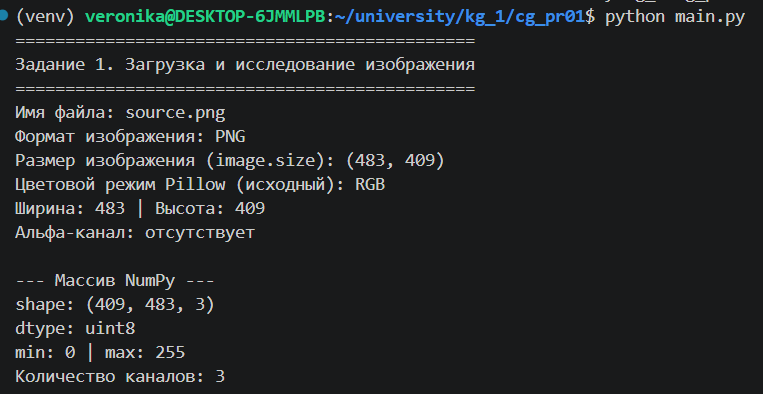
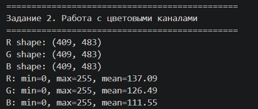
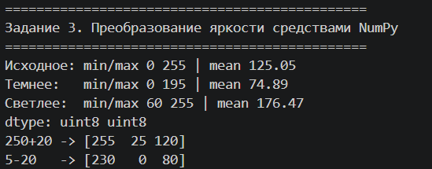
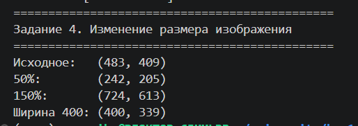
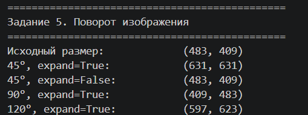
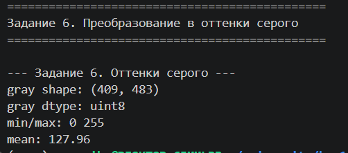
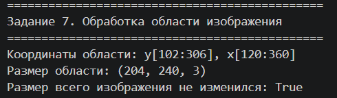

# Задание 1. Загрузка и исследование изображения

Программа загружает изображение (`assets/source.jpg`) с помощью **Pillow** и выводит его характеристики: имя файла, формат, размер, цветовой режим, ширину и высоту, наличие альфа-канала.

Затем изображение преобразуется в массив **NumPy**, и выводятся `shape`, `dtype`, минимальное и максимальное значения, количество каналов и RGB-значения трёх пикселей.

`image.size` возвращает `(ширина, высота)`, а `array.shape` возвращает `(высота, ширина, каналы)`: массив хранится как матрица, где сначала идут строки (y), затем столбцы (x). Поэтому пиксель (x, y) читается как `array[y, x]`.

## Результат

# Задание 2. Работа с цветовыми каналами

Каналы R, G и B выделены из массива NumPy срезами (`array[:, :, 0]`, `array[:, :, 1]`, `array[:, :, 2]`) без использования `getchannel` из Pillow. Для каждого канала посчитаны минимальное, максимальное и среднее значения интенсивности (`min()`, `max()`, `mean()`).

Затем созданы три изображения, в каждом из которых сохранён только один канал: остальные два обнулены через `np.zeros_like`. Результаты сохранены в папку `output/` в формате PNG (без потерь):

- `red_channel.png`
- `green_channel.png`
- `blue_channel.png`

Сравнение средних значений показывает, какой цвет преобладает на изображении.

## Результат

# Задание 3. Преобразование яркости средствами NumPy

Реализована функция `change_brightness(image_array, delta)`, изменяющая яркость изображения на величину `delta`.

Перед сложением массив приводится к типу `int16`, чтобы избежать переполнения `uint8` (например, `250 + 20` не превращается в маленькое число). После сложения значения обрезаются в диапазон `[0, 255]` через `np.clip`, и массив возвращается обратно в `uint8`.

С помощью функции созданы:

- затемнённое изображение (`delta = -60`);
- осветлённое изображение (`delta = 60`).

Результаты сохранены в папку `output/`:

- `darker.png`
- `brighter.png`

# Задание 4. Изменение размера изображения

Реализована функция `resize_to_width(image, target_width)`, которая приводит изображение к заданной ширине с сохранением пропорций. Новая высота вычисляется вручную по формуле `new_height = old_height × new_width / old_width`, изменение размера выполняется методом `image.resize()` с ресэмплингом `LANCZOS`.

С помощью функции созданы три версии изображения:

- уменьшенная до 50% исходного размера;
- увеличенная в 1,5 раза;
- приведённая к фиксированной ширине 400 px с сохранением пропорций.

Результаты сохранены в папку `output/`:

- `resized_50.png`
- `resized_150.png`
- `resized_fixed_width.png`

Изменение размера массива NumPy (срез, обрезка) просто выбирает существующие пиксели без пересчёта значений. Ресэмплинг Pillow (`LANCZOS`) при изменении размера пересчитывает новые пиксели на основе соседних старых через интерполяцию, поэтому даёт плавное изображение без искажений, в отличие от простого прореживания массива.

## Задание 5. Поворот изображения

Реализована функция `rotate(image, angle, expand)`, выполняющая поворот изображения на заданный угол с использованием интерполяции `BICUBIC`. Для вновь появляющихся при повороте областей явно задан белый цвет заливки (`fillcolor=(255, 255, 255)`).

Созданы повороты на:

- 45°;
- 90°;
- произвольный угол 120° (задаётся пользователем).

Дополнительно выполнено сравнение параметра `expand`:

- при `expand=False` размер холста не меняется, поэтому углы повернутого изображения обрезаются;
- при `expand=True` Pillow автоматически увеличивает холст так, чтобы вместить всё повернутое изображение без обрезки.

Результаты сохранены в папку `output/`:

- `rotated_45.png`
- `rotated_90.png`
- `rotated_120.png`
- `rotated_45_no_expand.png` (для сравнения с `expand=False`)

## Задание 6. Преобразование в оттенки серого

Изображение переведено в оттенки серого с помощью встроенного метода Pillow `image.convert("L")`. В результате массив NumPy становится двумерным (`(высота, ширина)` вместо `(высота, ширина, 3)`), так как вместо трёх цветовых каналов остаётся один канал яркости.

Выведены `shape`, `dtype`, минимальное, максимальное и среднее значения яркости.

Результат сохранён в папку `output/`:

- `gray.png`

## Задание 7. Локальное преобразование области изображения

Выбрана прямоугольная область в центре изображения с помощью среза NumPy `array[y1:y2, x1:x2]`. Внутри этой области выполнен перевод в оттенки серого по формуле яркости `0.299·R + 0.587·G + 0.114·B`, результат записан обратно во все три канала только внутри выбранных границ. Остальная часть изображения осталась без изменений.

Результат сохранён в папку `output/`:

- `local_transform.png`

## Задание 8. Формирование итогового изображения

С помощью **Matplotlib** собрана итоговая композиция из шести результатов обработки в сетке 2×3, каждый со своим заголовком:

1. исходное изображение;
2. уменьшенное до 50%;
3. повёрнутое на 45°;
4. переведённое в оттенки серого;
5. изображение с увеличенной яркостью;
6. изображение с локально обработанной областью.

Результат сохранён в папку `output/`:

- `summary.png`